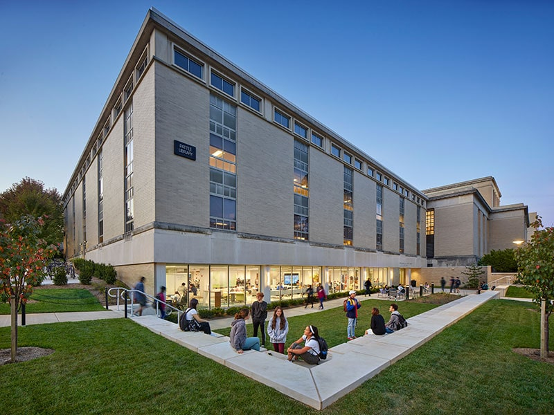

## About

This site documents and describes the 2027 Open Scholarship Bootcamp to be held on the University Park campus of [the Pennsylvania State University](https://www.psu.edu) Monday, May 10 and Tuesday, May 11, 2027.

## Goals {.unnumbered}

- To create a focal point for activity and learning related to open scholarship practices.
- To accelerate the development of a community of scholars who are interested in open scholarship.
- To plan next steps that will foster the emergence of a robust open scholarship community at Penn State.

::: callout-important
## To register
Visit < https://forms.gle/45EXJomr5yu6DHq19>.
:::

## Location

The Bootcamp will be held at the Pattee and Paterno Libraries on the Penn State University Park campus.
The Dewey Room on Ground floor of the Collaboration Commons in (W043) Pattee Library is the principal location. 
<!-- See [this link](wayfinding.qmd) for specific directions. -->

